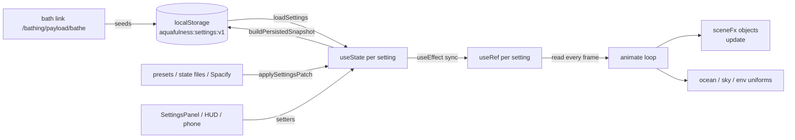

# Architecture overview

:::note Describes `main` as of 2026-11-16
This page documents the current structure. The plugin-based `apps/` refactor
will move a lot of it; see [Apps: the plugin architecture](plugin-refactor.md) (PR #52).
:::

## Folder map

```text
src/
  routes/                 TanStack file routes (one .tsx per URL)
    index.tsx             "/" — the whole app: SplashScreen + Aquafulness() (~16 000 lines)
    bathing.$payload*.tsx bath links: decode, preview, and "bathe" (seed + mount the app)
    about.tsx, docs*.tsx, licenses.tsx, auth.spacify.tsx, login.tsx
    __root.tsx            app shell
  components/
    SettingsPanel.tsx     every settings control (~6 000 lines), used twice (HUD + virtual phone)
    settingsNav.tsx       groups, search and tabs carousel around SettingsPanel
    SettingRow.tsx        one settings row (value summary + sheet with slider/+-/options)
    PadDial.tsx           older compact dial, same props as SettingRow
    Joystick.tsx          on-screen sticks (NAV wheel, levers, KROPP…)
    HudControls.tsx       HudIconButton for the right-hand mode column
    VirtualPhone.tsx      the in-scene phone ("bathOS") with Fjärrkontroll and Inställningar apps
    WindPanel.tsx, HoodSettings.tsx, DecorationPanel.tsx, StringLightsSettings.tsx
                          feature UIs split out of SettingsPanel
    GogglesOverlay.tsx, ShareBathDialog.tsx, TimeTravelDialog.tsx, ScenerySelectorDialog.tsx, …
    ui/                   shadcn/ui primitives
  lib/
    settingsShared.ts     Persisted type, option lists, PRESET_TAB_FIELDS
    sceneFx/              self-contained scene effects (snow, aurora, fireworks, hood, …)
    ocean/                FFT ocean spectrum (REALISTISKA VÅGOR)
    raytracedWater/       RAYTRACED water material (port of Evan Wallace's WebGL Water)
    torusRings/           BADRINGAR (floating bath rings)
    watercraft/           FARKOST raft with voxel/clay building
    tv/                   CSS3D TV/phone panels placed in the scene
    wind.ts, windSound.ts, openDrift.ts, stringLights.ts, decorations.ts, hoodLayers.ts
                          feature logic that isn't a three.js object
    presets.ts, sceneryPresets.ts, shareState.ts, userScenes.ts
                          saving, loading, exporting and sharing
    appCatalog.ts         discovers content under public/apps/
    extremeLimits.ts, uiTheme.ts
                          visitor preferences with their own storage key
    spacify.ts, spacifySync.ts  optional "Sign in with Spacify" sync
    deviceFiles.ts, appLinks.ts, liveUpdate.ts, ambientAudio.ts
                          Capacitor bridges
    offlineAssets.ts, register-sw.ts  offline precache
    i18n.ts
  hooks/                  use-decorations, use-spacify-sync, use-offline-precache, …
  locales/                sv, en, no, da, fi
  sw.ts                   service worker (Workbox, injectManifest)
public/apps/              content packs: scenes (.glb), skyboxes, surfaces, audio + manifests
android/                  Capacitor Android project with hand-registered plugins
native/                   experimental Expo + react-native-webgpu port (not built in CI)
docs/                     theory documents (published under /theory on this site)
website/                  this Docusaurus site
```

## Routes

| URL | File | Purpose |
| --- | --- | --- |
| `/` | `routes/index.tsx` | Splash screen, then the bath (`Aquafulness()`) |
| `/bathing/$payload` | `bathing.$payload.tsx` | Decodes the base62 payload once (loader) and sets Open Graph meta |
| `/bathing/$payload/` | `bathing.$payload.index.tsx` | Preview page of a shared bath |
| `/bathing/$payload/bathe` | `bathing.$payload.bathe.tsx` | Seeds localStorage from the payload, then mounts the same `Aquafulness` component |
| `/docs/*` | `docs*.tsx` | In-app theory pages |
| `/about`, `/licenses` | | Info pages |
| `/auth/spacify` | `auth.spacify.tsx` | OAuth callback for Spacify sign-in |
| `/login` | `login.tsx` | soarfulness only |

`src/routes/README.md` has the TanStack routing conventions. Never edit
`routeTree.gen.ts` by hand.

## The `Aquafulness()` component

`export function Aquafulness()` in `routes/index.tsx` is the app. In file
order it contains:

1. **Module-level helpers and constants** above it: wave functions
   (`shapedWave`, `waveHeight`, `whirlpoolSurfaceHeight`), RIDE rig builders
   (`buildFreakOutRig`, `freakOutPose`), ocean and cloud sizes,
   `STORAGE_KEY`, `DEFAULTS`, `FIRST_START_POSE`, `loadSettings()`,
   `loadCameraPose()`, `buildCurrentBathPayload()` and `SplashScreen`.
2. **State**: about 350 `useState` hooks, one per setting, initialised from
   `initial = loadSettings()`.
3. **Refs**: about 370 `useRef`s. Every setting the render loop reads gets a
   `fooRef` kept in sync by a small `useEffect`.
4. **Derived helpers and effects**: EXTREME clamp effect, `buildPersistedSnapshot()`,
   the autosave effect, `resetToDefaults()`, `applySettingsPatch()`, preset/state
   import and export, scene/environment/surface loaders.
5. **The mount effect** (`useEffect(…, [])`, starting around
   `new THREE.WebGLRenderer`): builds the renderer, scene, camera, ocean,
   floor, clouds, sky, environment dome and every `sceneFx` object, then runs
   `animate()` until unmount, where everything is disposed.
6. **JSX**: the canvas mount, overlays (underwater fog, goggles), the HUD
   (sticks, mode column, camera drawer), the settings dialog
   (`<SettingsPanel {...settingsPanelProps} />`) and the virtual phone.

`settingsPanelProps: SettingsPanelProps` near the end collects every value
and setter the panel needs. The same object feeds the HUD's settings dialog
and the phone's Inställningar app.

## Data flow



Visitor preferences that must not travel with presets or links (UI theme,
EXTREME, EXPERIMENTELLT LÄGE, string lights, settings layout, language) use
their own small stores with `useSyncExternalStore` and their own storage key
instead of `Persisted`.
